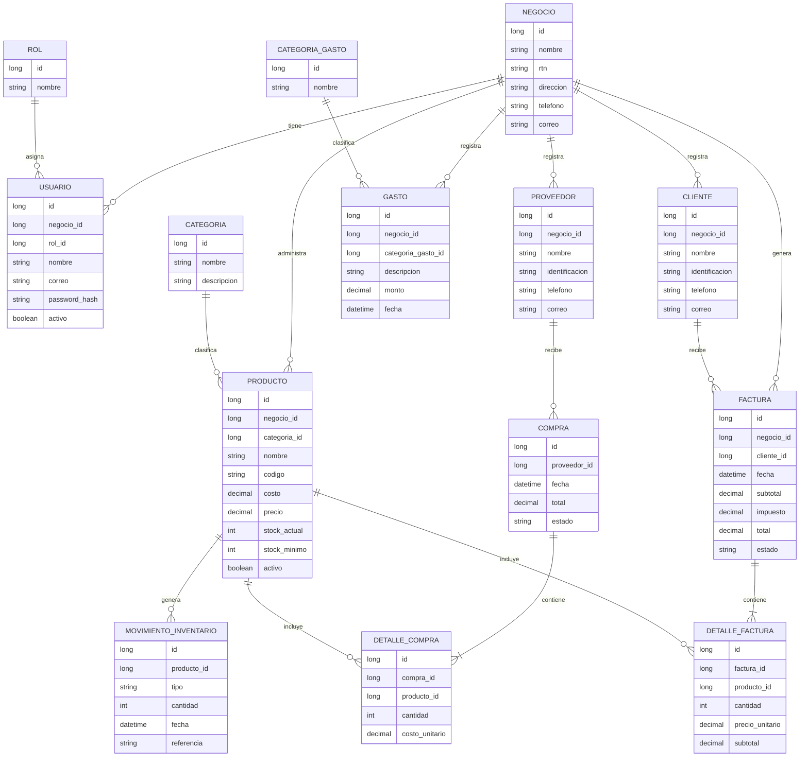

# NegocioGo Management

**NegocioGo Management** es una aplicación web *mobile-first* orientada a pequeños negocios para facilitar la administración de inventario, gastos, facturación y usuarios desde una interfaz accesible principalmente desde dispositivos móviles.

El proyecto está siendo desarrollado como una aplicación distribuida basada en **React, Java, Spring Boot y microservicios**, utilizando Oracle Cloud para servicios de base de datos.

> 🚧 **Estado:** Proyecto en desarrollo. Algunas funcionalidades y módulos descritos en este documento forman parte de la arquitectura planificada y aún no están implementados.

---

## Objetivo

Crear una plataforma sencilla para que pequeños negocios puedan administrar desde un solo lugar:

* Inventario y productos.
* Entradas y salidas de inventario.
* Gastos del negocio.
* Clientes y proveedores.
* Ventas y facturación.
* Usuarios y roles.
* Historial de operaciones.
* Reportes básicos.

La interfaz está diseñada siguiendo un enfoque **mobile-first**, permitiendo su uso desde teléfonos, tablets y computadoras.

---

## Arquitectura

Actualmente el proyecto se está desarrollando utilizando una arquitectura basada en microservicios.

```text
                React
                  │
                  │ HTTP / REST
                  ▼
             API Gateway
                  │
        ┌─────────┴─────────┐
        │                   │
        ▼                   ▼
 Auth Service          Servicios futuros
 Login / JWT           Inventario
                       Ventas
                       Gastos
                       Facturación
        │                   │
        └─────────┬─────────┘
                  │
                  ▼
          Oracle Cloud Database
```

### Componentes actuales

* **Frontend:** React
* **Backend:** Java + Spring Boot
* **Build:** Maven
* **Arquitectura:** Microservicios
* **API Gateway:** Spring Cloud Gateway
* **Comunicación:** REST API
* **Autenticación:** basada en tokens / JWT
* **Base de datos:** Oracle Cloud
* **Control de versiones:** Git + GitHub

---

## Tecnologías

### Frontend

* React
* JavaScript
* HTML5
* CSS3
* Vite
* Fetch API para comunicación con el backend

### Backend

* Java
* Spring Boot
* Spring Cloud Gateway
* Maven
* REST APIs
* Autenticación mediante tokens

### Cloud y datos

* Oracle Cloud Infrastructure
* Oracle Database
* Variables de entorno para configuración sensible

---

## Funcionalidades

### Implementadas / en desarrollo

* [x] Estructura inicial de microservicios.
* [x] API Gateway.
* [x] Microservicio de autenticación.
* [x] Comunicación entre servicios.
* [x] Conexión con base de datos alojada en Oracle Cloud.
* [x] Autenticación mediante token.
* [ ] Integración completa del frontend React.
* [ ] Despliegue del frontend.

### Planificadas

* [ ] Gestión de usuarios.
* [ ] Roles y permisos.
* [ ] Gestión de productos.
* [ ] Categorías de productos.
* [ ] Control de inventario.
* [ ] Movimientos de entradas y salidas.
* [ ] Clientes.
* [ ] Proveedores.
* [ ] Registro de gastos.
* [ ] Compras.
* [ ] Ventas.
* [ ] Generación de facturas.
* [ ] Reportes.
* [ ] Dashboard del negocio.

---

# Diseño de base de datos

Actualmente la base de datos se encuentra en desarrollo.

El siguiente modelo representa la **arquitectura de datos planificada** para las siguientes etapas del proyecto.



---

## Flujo general

Un usuario autenticado accede al sistema mediante React.

```text
Usuario
   ↓
React
   ↓
Login
   ↓
API Gateway
   ↓
Auth Service
   ↓
Token JWT
   ↓
Servicios autorizados
   ↓
Oracle Database
```

El token será utilizado para validar el acceso a los diferentes recursos de acuerdo con el rol del usuario.

Ejemplos de roles planificados:

* Administrador
* Propietario
* Vendedor
* Encargado de inventario

---

## Seguridad

Las credenciales y archivos sensibles no se almacenan en este repositorio.

Se excluyen mediante `.gitignore`:

* Variables `.env`.
* Oracle Wallet.
* Contraseñas.
* Tokens.
* Certificados.
* Claves privadas.

El proyecto utiliza archivos `.env.example` como referencia de configuración sin publicar credenciales reales.

---

## Base de datos Oracle Cloud

La base de datos de desarrollo se encuentra alojada en **Oracle Cloud Infrastructure (OCI)**.

Los archivos de Oracle Wallet necesarios para establecer conexiones seguras **no se incluyen en el repositorio**.

El modelo de datos continuará evolucionando conforme se desarrollen los diferentes microservicios.

---

## Roadmap

### Fase 1 — Arquitectura

* [x] Spring Boot
* [x] Maven
* [x] API Gateway
* [x] Auth Service
* [x] Oracle Cloud Database
* [x] Autenticación por token

### Fase 2 — Frontend

* [x] Base del proyecto React
* [ ] Integración completa React ↔ API Gateway
* [ ] Gestión de sesiones
* [ ] Protección de rutas por rol
* [ ] Diseño responsive mobile-first

### Fase 3 — Inventario

* [ ] Productos
* [ ] Categorías
* [ ] Stock
* [ ] Entradas y salidas
* [ ] Alertas de stock mínimo

### Fase 4 — Gestión comercial

* [ ] Clientes
* [ ] Proveedores
* [ ] Compras
* [ ] Gastos

### Fase 5 — Ventas y facturación

* [ ] Ventas
* [ ] Detalle de ventas
* [ ] Facturación
* [ ] Generación de comprobantes

### Fase 6 — Analítica

* [ ] Dashboard
* [ ] Reportes de ventas
* [ ] Reportes de gastos
* [ ] Historial de inventario

---

## Autor

**Indira Zaldivar**

Ingeniera en Informática enfocada en desarrollo de software, Java, Spring Boot, React y tecnologías cloud.

GitHub: [Indi0101](https://github.com/Indi0101)
